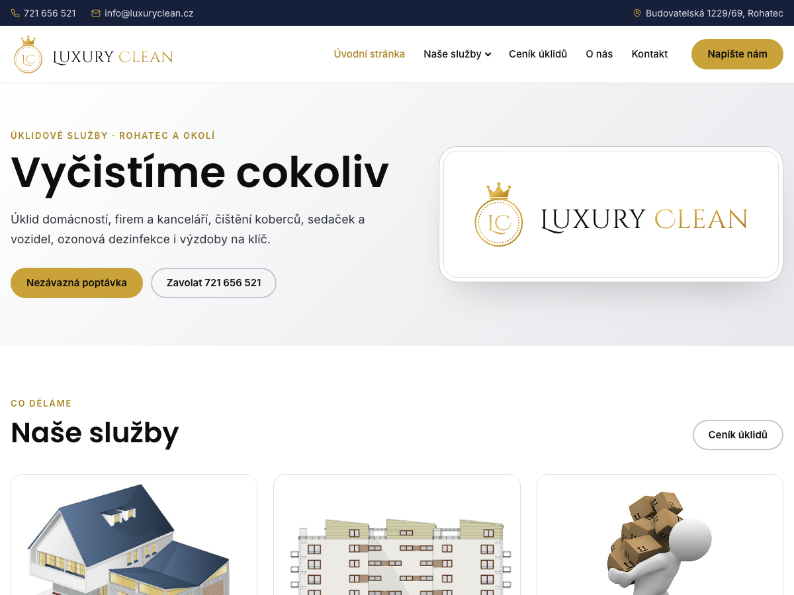

# Luxury Clean — WordPress šablona a plugin

[](https://github.com/elvisek2020/wp-theme_luxuryclean/releases/latest)


Vlastní šablona a plugin webu [www.luxuryclean.cz](https://www.luxuryclean.cz) (úklidové služby),
které nahrazují šablonu Blockskit a většinu pluginů z wordpress.org.



| Balíček | Typ | Popis |
|---|---|---|
| `luxuryclean` | šablona | vzhled, logo, úvodní stránka, SEO, GA4 s cookie lištou, lightbox, světlý a tmavý režim |
| `luxuryclean-core` | plugin | bezpečnost přihlášení, hardening, sitemap, údržba, aktualizace — nezávislý na šabloně |

Oba balíčky se vydávají společně se stejnou verzí z tagu `vX.Y.Z` (`luxuryclean.zip`, `luxuryclean-core.zip`).

## Šablona Luxury Clean

**Vzhled**
- Světlý režim „Svěží“ (bílá, černá, zlatá, stříbrná, tmavě modrá), tmavý „Noc a zlato“, přepínač Systém / Světlý / Tmavý v patičce.
- Logo jako SVG podle původního (korunka, LC, nápis v Cinzel Decorative), písma lokálně.
- Mobile first, rozbalovací menu na mobilu, bez jQuery.

**Obsah**
- Úvod s logem, karty služeb z tabulky na úvodní stránce, vybrané ceny, výzva k poptávce.
- Stránky s pruhem nadpisu, formuláře Forminator v barvách šablony.

**Technicky**
- Kanonické moduly `inc/ekt/`: SEO, GA4 s cookie lištou a Consent Mode v2, externí odkazy, lightbox, embedy, sítě, světlý a tmavý režim, aktualizace z GitHubu.

| Přizpůsobit | Volby |
|---|---|
| Kontakty a úvod | telefon, e-mail, adresa, texty úvodu a výzvy, vybrané ceny |
| Patička | copyright, text za copyrightem, odkaz Administrace |
| SEO a analytika | GA4 ID, popis webu |
| Sociální sítě | odkazy (prázdné = ikony se nezobrazí) |

## Plugin Luxury Clean Core

Nahrazuje 4 dřívější pluginy a funguje nezávisle na šabloně.

| Oblast | Co dělá |
|---|---|
| Přihlášení | limit pokusů s eskalací blokace, log přihlášení, sloupec Poslední přihlášení |
| Bezpečnost | vypnuté XML-RPC a editor souborů, skrytá verze a uživatelská jména, bezpečnostní hlavičky |
| Sitemap | vestavěná `wp-sitemap.xml` bez uživatelů, přesměrování ze `sitemap_index.xml` |
| Aktualizace | automatické aktualizace WordPressu a pluginů, vlastní plugin a šablona z GitHub Releases |
| Kontaktní formulář | shortcode `[ekc_contact_form]` (převezme i `[forminator_form]`), antispam bez reCAPTCHA, e-mail správci, Zprávy z webu v administraci |
| Administrace | PHP, DB, IP a paměť v patičce, widget Zdraví webu |

**Údržba webu** (Nástroje → Údržba webu): tabulky a autoload, úklid revizí a transientů, největší a nepoužité soubory, rozbité interní odkazy, pozůstatky odebraných pluginů do karantény.

## Požadavky

- WordPress 6.5+
- PHP 8.1+

## Instalace

1. Stáhni `luxuryclean-core.zip` a `luxuryclean.zip` z [posledního vydání](https://github.com/elvisek2020/wp-theme_luxuryclean/releases/latest).
2. Pluginy → Instalace pluginů → Nahrát plugin → `luxuryclean-core.zip`, aktivovat.
3. Vzhled → Šablony → Přidat → Nahrát šablonu → `luxuryclean.zip`, ověřit v Živém náhledu a aktivovat.
4. Vzhled → Menu: hlavní menu do umístění „Hlavní menu“ (sloupce patičky se doplní z něj samy).

## Aktualizace

Plugin i šablona se aktualizují z GitHub Releases (Administrace → Aktualizace).

## Vývoj

```
plugins/luxuryclean-core/   plugin (kanonické moduly ekc_)
theme/luxuryclean/          šablona (kanonické moduly ekt_, vzhled a projektové inc/site-*.php)
dev/                        lokální WordPress v Dockeru (dev/README.md)
```
